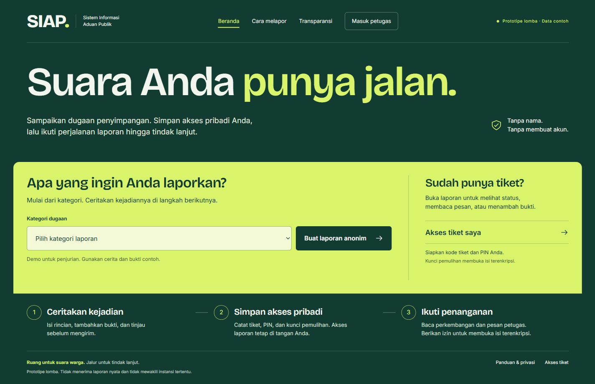
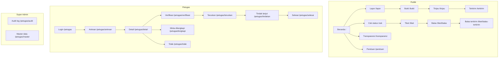
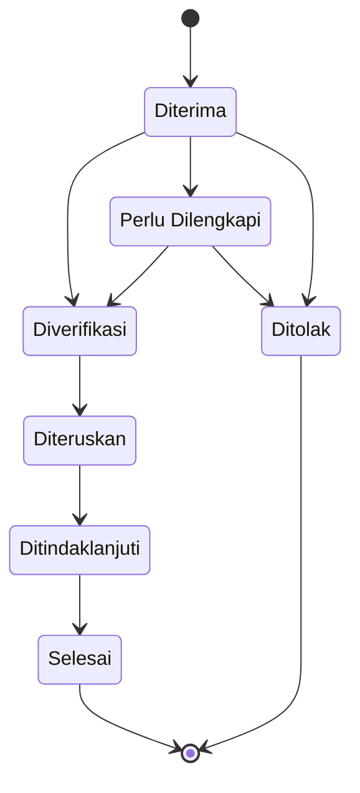
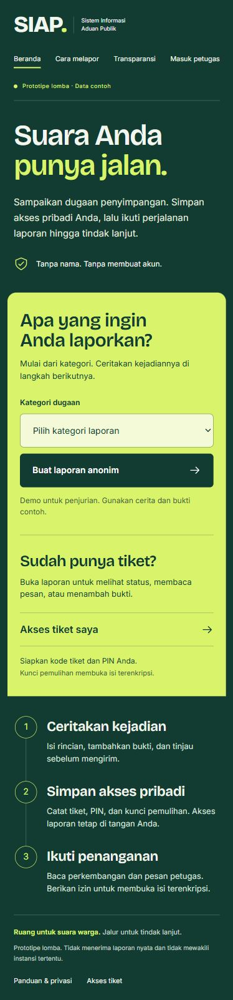
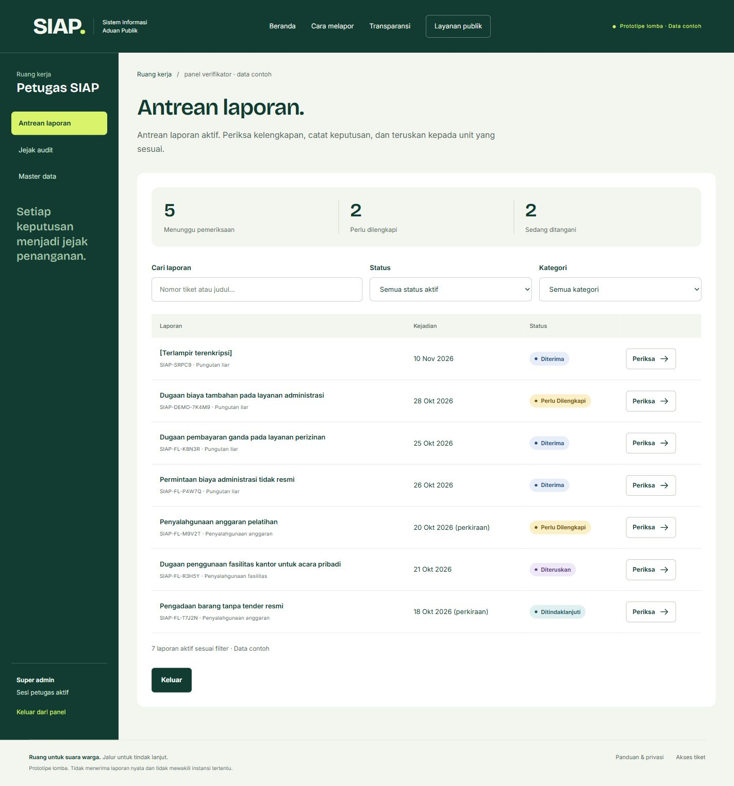
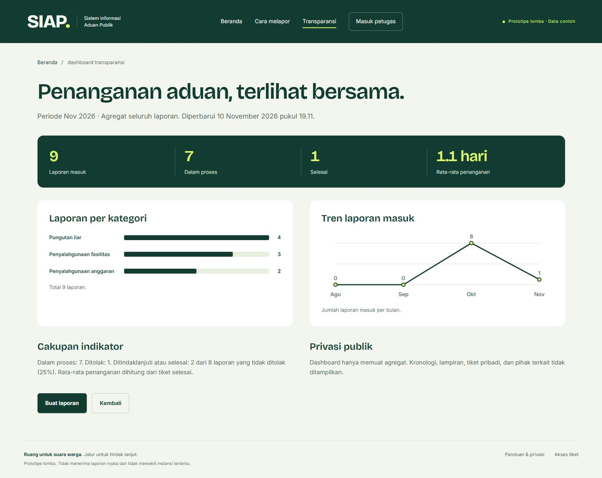

# SIAP — Sistem Informasi Aduan Publik

> **Suara Anda punya jalan.**
> SIAP menyediakan alur pelaporan dugaan penyimpangan tanpa meminta nama atau kontak pelapor. Pelapor menyimpan **kode tiket, PIN 6 digit, dan kunci pemulihan** untuk mengakses laporan terenkripsi serta mengikuti penanganannya. Petugas bekerja melalui antrean, pesan, dan keputusan yang tercatat di database.

**Status:** Prototipe lomba (backend SQLite aktif) · **Seluruh data adalah contoh** · Tidak menerima laporan sungguhan.



Antarmuka **Ruang Warga** menghubungkan beranda, formulir, tiket, transparansi, dan ruang kerja petugas melalui satu identitas visual. Screenshot di atas berasal dari aplikasi yang berjalan, bukan mockup.

---

## Daftar Isi

1. [Redesign Ruang Warga](#redesign-ruang-warga)
2. [Latar Belakang & Tujuan](#latar-belakang--tujuan)
3. [Fitur Utama](#fitur-utama)
4. [Tech Stack](#tech-stack)
5. [Cara Menjalankan](#cara-menjalankan)
6. [Akun & Tiket Demo](#akun--tiket-demo)
7. [Struktur Folder](#struktur-folder)
8. [Sitemap](#sitemap)
9. [Alur Status](#alur-status)
10. [Keterlacakan PRD](#keterlacakan-prd)
11. [Screenshot](#screenshot)
12. [Desain & Wireframe](#desain--wireframe)
13. [Status & Progress](#status--progress)
14. [Keamanan & Batasan](#keamanan--batasan)

---

## Redesign Ruang Warga

Ruang Warga dipilih untuk membuat mekanisme SIAP mudah dipahami saat demo lomba: mulai laporan, simpan akses pribadi, lalu ikuti penanganan.

- **Identitas:** hijau pekat, kuning-hijau, judul Bricolage Grotesque, dan teks Inter; kedua font disajikan dari aplikasi sendiri.
- **Beranda yang bisa dipakai:** kategori laporan langsung diteruskan ke formulir; akses tiket tersedia dalam area aksi yang sama.
- **Alur publik:** indikator bernama **Kejadian → Bukti → Tinjau**, validasi per isian, linimasa tiket, dan pesan kesalahan akses yang dapat diperbaiki langsung.
- **Ruang kerja petugas:** navigasi sesuai peran, tabel antrean di desktop, daftar pada ponsel, pencarian berjeda, serta keadaan memuat, kosong, dan gagal yang berbeda.
- **Responsif dan aksesibel:** filter ponsel ditumpuk, label grafik terbaca, ikon SVG konsisten, fokus keyboard terlihat, serta dukungan preferensi pengurangan animasi.

Untuk presentasi, gunakan urutan **beranda → laporan contoh → tiket → antrean petugas → transparansi**. Rincian tersedia di [panduan redesign dan demo](docs/redesign-ruang-warga.md).

Kebenaran produk dicatat di [PRODUCT.md](PRODUCT.md), sedangkan token dan pola visual ada di [DESIGN.md](DESIGN.md). Konfigurasi, metadata komponen, dan brief halaman yang perlu ikut Git berada di `.impeccable/`; hasil review, mockup percobaan, dan cache diabaikan secara otomatis.

---

## Latar Belakang & Tujuan

Pelaporan dugaan penyimpangan sering terhambat rasa takut terhadap pembalasan. SIAP dirancang sebagai ruang aman untuk bersuara:

- **Anonim sejak awal** — formulir tidak meminta nama, email, atau nomor telepon.
- **Akses pribadi berbasis tiket + PIN** — pelapor tidak perlu membuat akun; kunci pemulihan membuka isi laporan terenkripsi.
- **Tindak lanjut yang terlihat** — status, pesan admin, permintaan kelengkapan, dan ringkasan hasil dapat dibaca pelapor.
- **Transparansi publik** — dashboard agregat menampilkan tren penanganan tanpa membuka isi aduan.

Tujuan prototipe: mendemonstrasikan alur pelaporan anonim ujung-ke-ujung (pelapor, petugas, super admin, publik) sebagai dasar pengembangan sistem produksi.

---

## Fitur Utama

### Untuk pelapor

- Formulir laporan **3 langkah**: kejadian → bukti → tinjau.
- Unggah bukti JPG/PNG/PDF (maksimal 5 berkas, 10 MB per berkas).
- Penerbitan **kode tiket, PIN, dan kunci pemulihan** beserta peringatan penyimpanan.
- Cek status dengan tiket + PIN; kunci pemulihan diperlukan untuk membuka isi laporan terenkripsi.
- Izin eksplisit dari pelapor sebelum petugas dapat membaca isi laporan terenkripsi.
- Balas permintaan admin dengan pesan dan bukti tambahan.
- Membaca ringkasan hasil dan dokumen hasil saat tiket selesai.

### Untuk petugas (verifikator)

- Login petugas dengan peran `verifikator`.
- Antrean laporan aktif dengan filter status, kategori, dan pencarian berjeda.
- Detail laporan + catatan internal.
- Transisi status: **verifikasi, minta dilengkapi, tolak, teruskan, tindak lanjut, selesai** — semuanya wajib beralasan dan tercatat.

### Untuk super admin

- Semua kemampuan verifikator.
- **Audit log** akses dan keputusan (hanya-baca).
- **Master data**: tambah, ubah nama, aktifkan/nonaktifkan kategori dan unit tujuan; lihat daftar akun petugas.

### Untuk publik

- Dashboard transparansi: statistik agregat, laporan per kategori, dan tren laporan masuk.
- Panduan & privasi.

---

## Tech Stack

| Lapisan                 | Teknologi                                        |
| ----------------------- | ------------------------------------------------ |
| UI                      | React 19 + TypeScript                            |
| Build                   | Vite 8                                           |
| Routing                 | React Router 8                                   |
| Styling                 | Tailwind CSS 4 + CSS design token kustom         |
| Lint                    | Oxlint                                           |
| Font                    | Bricolage Grotesque Variable + Inter Variable (Fontsource, disajikan lokal) |
| Backend                 | Express 5 + TypeScript (`tsx` dev server)        |
| Database                | SQLite (`better-sqlite3`) — otomatis dibuat saat server start |
| Sesi                    | Cookie `httpOnly` + store SQLite (`express-session`) |
| Validasi server         | Zod                                              |
| Upload bukti            | Multer (disk storage, nama acak)                 |

---

## Cara Menjalankan

Prasyarat: **Node.js 22.12+ atau 24+** dan npm. Jalankan perintah dari root repositori; dependensi frontend dan backend dipasang secara terpisah.

Jalankan **dua terminal** — backend dan frontend:

```bash
# Terminal 1 — server (port 3001)
cd server
npm ci
npm run dev

# Terminal 2 — web (port 5173)
cd web
npm ci
npm run dev        # http://localhost:5173
```

Perintah lain:

```bash
cd web
npm run lint       # oxlint
npm run build      # tsc -b && vite build
npm run preview    # menyajikan hasil build

cd server
npm run build      # tsc -p tsconfig.json
```

> Database (`server/data/siap.db`) dan sesi dibuat **otomatis** saat server start, termasuk seed data demo (idempoten — restart tidak menduplikasi). Vite mem-proxy `/api` ke `http://localhost:3001`, tanpa CORS.

---

## Akun & Tiket Demo

### Akun petugas

| Email                        | Kata sandi    | Peran       |
| ---------------------------- | ------------- | ----------- |
| `verifikator@contoh.invalid` | `verif-admin` | verifikator |
| `pengelola@contoh.invalid`   | `super-admin` | super_admin |

Akses panel petugas melalui **“Masuk petugas”** pada navigasi utama atau langsung ke `/petugas`. Navigasi **Jejak audit** dan **Master data** tersedia untuk super admin.

### Tiket contoh

| Kode tiket        | PIN      | Status           |
| ----------------- | -------- | ---------------- |
| `SIAP-DEMO-7K4M9` | `482619` | Perlu Dilengkapi |
| `SIAP-DEMO-2Q6R8` | `730215` | Selesai          |
| `SIAP-FL-K8N3R`   | `901234` | Diterima         |
| `SIAP-FL-P4W7Q`   | `567890` | Diterima         |
| `SIAP-FL-M9V2T`   | `345678` | Perlu Dilengkapi |
| `SIAP-FL-B6D8L`   | `234567` | Ditolak          |
| `SIAP-FL-R3H5Y`   | `123456` | Diteruskan       |
| `SIAP-FL-T7J2N`   | `890123` | Ditindaklanjuti  |

Semua tiket, nama unit, dan percakapan adalah **data contoh** untuk simulasi. Tiket contoh lama di atas dapat dibuka tanpa kunci pemulihan. Untuk laporan terenkripsi yang baru dibuat, simpan ketiga akses dari halaman terkirim; **kunci pemulihan tidak menggantikan PIN**.

---

## Struktur Folder

```
PRODUCT.md                    # pengguna, fungsi, dan batasan produk
DESIGN.md                     # token dan pola visual Ruang Warga
.impeccable/                  # konfigurasi, metadata desain, dan brief halaman
docs/                         # panduan redesign/demo dan threat model

server/                       # backend (Express 5 + SQLite)
├── src/
│   ├── index.ts              # app + sesi + mount route + proxy target
│   ├── db.ts                 # init DB, skema, seed demo idempoten
│   ├── session-store.ts      # session store di atas better-sqlite3
│   ├── tickets.ts            # assembler view tiket + transisi legal
│   ├── middleware/           # requireAuth, requireRole, rate-limit
│   └── routes/               # auth, public, admin, uploads
├── data/                     # siap.db (gitignored, dibuat otomatis)
└── uploads/                  # berkas bukti (gitignored)

web/                          # frontend (React 19 + Vite 8)
├── src/
│   ├── App.tsx               # definisi 22 rute
│   ├── main.tsx
│   ├── styles.css            # design token & komponen CSS
│   ├── components/           # Layout, Page, Field, Icons, StatusBadge, dll.
│   ├── lib/
│   │   ├── types.ts          # tipe domain + konstanta validasi
│   │   ├── api.ts            # lapisan REST (api & adminApi) — fetch + cookie
│   │   ├── mock-data.ts      # kredensial/seed demo untuk tampilan
│   │   ├── format.ts         # format tanggal & ukuran Indonesia
│   │   └── upload.ts         # konstanta validasi berkas
│   └── pages/                # 22 halaman publik, petugas, super admin
├── docs/                     # screenshot implementasi untuk README
├── index.html
├── package.json
└── vite.config.ts            # proxy /api -> localhost:3001
```

---

## Sitemap



---

## Alur Status



Catatan: balasan pelapor **tidak otomatis** mengubah status. Tiket tetap `Perlu Dilengkapi` sampai admin memeriksa ulang.

---

## Keterlacakan PRD

| Kebutuhan | Layar                                                  |
| --------- | ------------------------------------------------------ |
| F-01–F-06 | `lapor`, `bukti`, `tinjau`, `terkirim`                 |
| F-09–F-12 | `cek`, `tiket`, `balas`, `balas-terkirim`              |
| F-13–F-17 | `petugas` (login), `antrean`, `detail`, `verifikasi`,  |
|           | `lengkapi`, `tolak`, `teruskan`, `tindakan`, `selesai` |
| F-18      | `petugas/audit`                                        |
| F-19      | `petugas/master` (kelola kategori/unit, daftar akun)  |
| F-20–F-23 | `transparansi`                                         |
| F-07–F-08 | Ditunda: identitas terverifikasi dan peta              |

---

## Screenshot

Screenshot implementasi **Ruang Warga**, diambil pada **10 November 2026** dengan backend demo aktif. Angka dan isi antrean dapat berubah mengikuti data contoh pada database.

Beranda desktop ditampilkan di awal README.

<details>
<summary>Beranda ponsel — lebar 390 px</summary>



</details>

### Antrean petugas



### Transparansi publik



---

## Desain & Wireframe

Sumber acuan untuk implementasi sekarang:

- [PRODUCT.md](PRODUCT.md): pengguna, tujuan, kemampuan, dan batasan produk.
- [DESIGN.md](DESIGN.md): warna, tipografi, komponen, dan perilaku responsif.
- [Metadata desain](.impeccable/design.json) dan [brief beranda](.impeccable/surfaces/web-src-pages-home-tsx.md).
- [Panduan redesign dan demo](docs/redesign-ruang-warga.md).

Tautan Figma berikut merupakan **referensi rancangan awal** dan belum mencerminkan seluruh redesign Ruang Warga:

- [Wireframe desktop](https://www.figma.com/design/I6y3NdiGXwkWVwcahYevbo/SIAP?node-id=8-4668)
- [Mock-up desktop](https://www.figma.com/design/I6y3NdiGXwkWVwcahYevbo/SIAP?node-id=9-3)
- [Prototype desktop](https://www.figma.com/proto/I6y3NdiGXwkWVwcahYevbo/SIAP?node-id=9-3&starting-point-node-id=9%3A3)
- [Prototype mobile](https://www.figma.com/proto/I6y3NdiGXwkWVwcahYevbo/SIAP?node-id=9-2296&starting-point-node-id=9%3A2296)

Rancangan awal mengikuti **PRD SIAP v1.0 (30 Oktober 2026)**. Implementasi React saat ini menyediakan 22 halaman publik, petugas, dan super admin.

---

## Status & Progress

### Redesign Ruang Warga ✅ (10 November 2026)

- [x] Identitas visual diterapkan pada halaman publik dan panel petugas.
- [x] Kategori dari beranda diteruskan ke formulir; indikator tiga tahap konsisten.
- [x] Antrean berbentuk tabel pada desktop dan daftar pada ponsel; filter ponsel menampilkan pilihan lengkap.
- [x] Ikon SVG bersama, label grafik ponsel terbaca, dan fokus keyboard terlihat.
- [x] Formulir petugas menampilkan kesalahan setelah percobaan kirim, dengan pesan yang terhubung ke isian.
- [x] Pemeriksaan tampilan pada lebar 390, 420, 1280, dan 1440 px.
- [x] Uji laporan contoh terenkripsi, akses tiket salah/benar, antrean/detail petugas, audit/master, panduan, dan transparansi.
- [x] Empat temuan material dari review desain diselesaikan dan diperiksa ulang.
- [x] Build TypeScript/Vite, lint, dan pemeriksaan whitespace lolos.
- [x] Sistem desain, konteks produk, brief halaman, serta panduan demo terdokumentasi.

Pengujian redesign mencakup keadaan awal, kirim kosong, dan koreksi isian pada keenam formulir transisi petugas. Seluruh transisi status valid dan seluruh jenis unggahan tidak diuji ulang dalam perubahan visual ini.

### Fase 0 — Polesan submission ✅ (9 November 2026)

- [x] README lengkap (deskripsi, fitur, tech stack, cara run, kredensial, progress)
- [x] Sitemap Mermaid + tabel keterlacakan PRD
- [x] Screenshot desktop & mobile di `web/docs/`
- [x] Grafik transparansi (bar kategori + sparkline tren)
- [x] Badge status konsisten di seluruh halaman
- [x] Empty state & loading skeleton
- [x] Lint bersih (0 warning) & build hijau
- [x] Audit responsivitas 390 px + navigasi mobile
- [x] Validasi form inline di alur lapor

### Fase 1 — Backend & database nyata ✅ (10 November 2026)

- [x] Express 5 + SQLite (better-sqlite3) + Zod + Multer + sesi cookie httpOnly
- [x] Auth admin: bcrypt, sesi httpOnly di SQLite, middleware `requireAuth`/`requireRole`
- [x] Endpoint publik: kategori, buat laporan (nomor+PIN server-side), cek tiket (rate-limit + sesi 30 menit), balasan, transparansi
- [x] Endpoint admin: antrean (filter/search), detail + audit `REPORT_VIEWED`, transisi status tervalidasi (409 bila ilegal), audit log, master data
- [x] Upload bukti ke server: validasi MIME/ukuran/jumlah di server, unduhan terautentikasi
- [x] `api.ts` bermigrasi dari `sessionStorage` ke REST API (mock-db dihapus)
- [x] Seed demo idempoten: 8 tiket + 2 admin (PIN tetap sama)
- [x] Lint 0 warning & build hijau

### Fase 2 — Panel admin fungsional ✅ (10 November 2026)

- [x] Error transisi 400/409 ditampilkan jelas; alur status persisten di database
- [x] Pesan dua arah admin–pelapor tersimpan dan tampil setelah refresh
- [x] CRUD kategori/unit dengan validasi duplikat; unit nonaktif tidak dapat dipilih
- [x] Endpoint audit/master dibatasi untuk `super_admin`; referensi baca-saja tersedia untuk kedua role
- [x] Audit log append-only di tingkat database; login, logout, akses laporan, transisi, dan perubahan master tercatat

### Transparansi berbasis data ✅ (10 November 2026)

- [x] Statistik total, status, kategori, rata-rata penanganan, dan tren 4 bulan dihitung dari SQLite
- [x] Periode dan waktu pembaruan dibuat dinamis; indikator cakupan mengikuti agregat database
- [x] UI tidak lagi menampilkan angka demo statis pada dashboard transparansi

### Fase 3 — Keamanan & anonimitas ✅ (10 November 2026)

- [x] Threat model & dokumentasi batasan (`docs/threat-model.md`)
- [x] Enkripsi end-to-end isi laporan & balasan pelapor (AES-GCM-256 di sisi klien)
- [x] File bukti dienkripsi sebelum keluar dari browser; metadata MIME/ukuran divalidasi server
- [x] Kunci pemulihan acak 128-bit tampil sekali di `/terkirim` (PIN 6 digit tidak cukup)
- [x] Berbagi akses eksplisit ke admin (data key dibungkus public key RSA-OAEP)
- [x] Header keamanan + rate-limit per-jalur (reuse `middleware/ratelimit.ts`)
- [x] Lint 0 warning & build hijau

---

## Keamanan & Batasan

Ini adalah **prototipe lomba**, bukan sistem produksi:

- Backend aktif (Express + SQLite): data tiket bertahan setelah browser ditutup dan konsisten antar perangkat pada server yang sama.
- PIN di-hash **PBKDF2-SHA256 (150.000 iterasi, salt 16 byte)** di server; PIN asli hanya tampil sekali di `/terkirim` dan tidak pernah dikirim ulang.
- Sesi admin & sesi tiket memakai cookie **httpOnly + SameSite=Lax** (secure di produksi); tidak ada token di localStorage. Identitas tampilan admin (email/peran/nama) disimpan di `localStorage` agar sesi antar-tab konsisten — token tetap **hanya** di cookie httpOnly.
- Cek tiket di-rate-limit (10 percobaan/menit/IP) dengan pesan gagal generik yang tidak mengungkap keberadaan tiket.
- Transisi status divalidasi di server (409 bila ilegal); audit log append-only.
- Batas upload (5 berkas, 10 MB, JPG/PNG/PDF) ditegakkan **di server**; berkas bukti hanya dapat diunduh dengan sesi tiket atau sesi petugas.
- Isi laporan, balasan pelapor, dan file bukti **terenkripsi end-to-end** (AES-GCM-256) di sisi klien; server hanya menyimpan ciphertext + wrapped key + salt. Kunci pemulihan acak 128-bit tampil sekali di `/terkirim` — tanpa kunci ini isi tidak dapat dibuka (detail di `docs/threat-model.md`).
- Admin hanya dapat membaca isi bila pelapor secara eksplisit menekan "Izinkan admin membaca" (data key dibungkus dengan public key RSA-OAEP admin). Tanpa izin, admin hanya melihat status dan metadata. Kunci privat admin demo disimpan di `localStorage` browser admin (simulasi — produksi harus di HSM/keychain).
- Metadata tetap plaintext untuk kebutuhan antrean & agregasi: kategori, status, waktu, dan tanggal kejadian — ini bocor informasi kasar dan dicatat jujur di threat model.
- Header keamanan: `X-Content-Type-Options: nosniff`, `X-Frame-Options: DENY`, `Referrer-Policy: no-referrer`. Rate-limit in-memory per-IP per-jalur: `/api/admin` 60/menit, `/api/admin/login` 10/menit, dan `/tickets/check` 10/menit.
- Endpoint audit dan master dibatasi di server: hanya `super_admin`; referensi kategori/unit aktif tersedia bagi kedua peran.
- Dashboard transparansi menampilkan agregasi real-time dari database SQLite.
- Data contoh tidak boleh diganti dengan data pribadi sungguhan.
- Klaim privasi pada prototipe ini bersifat **teknis-demonstratif**, bukan jaminan hukum.

---

## Disclaimer

SIAP adalah prototipe lomba. Seluruh nama unit, angka, tiket, bukti, dan percakapan merupakan **data contoh**. Aplikasi ini tidak menerima laporan nyata dan tidak mewakili instansi mana pun.
