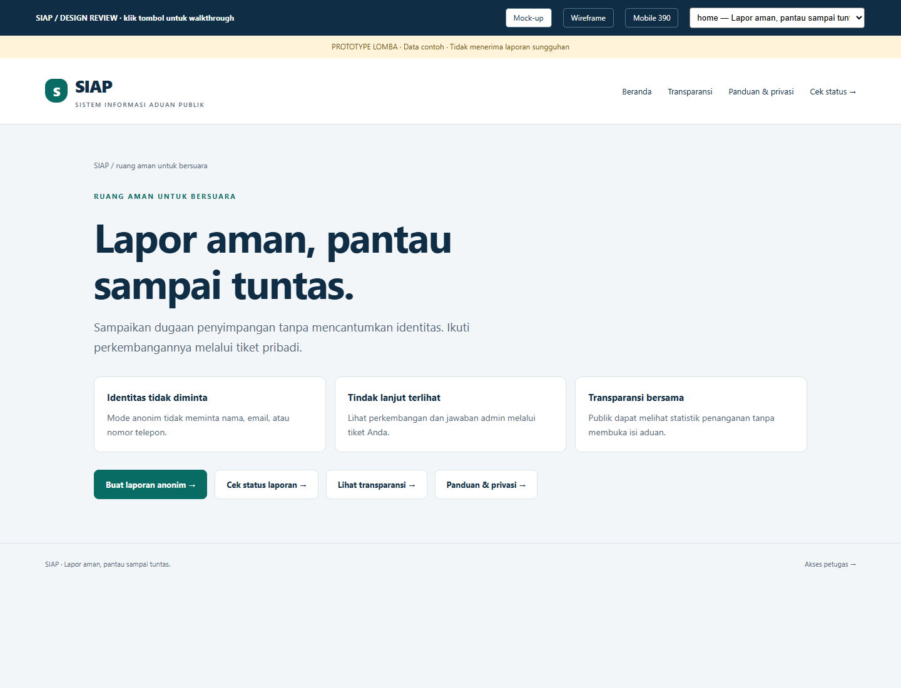
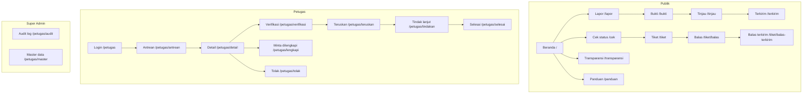
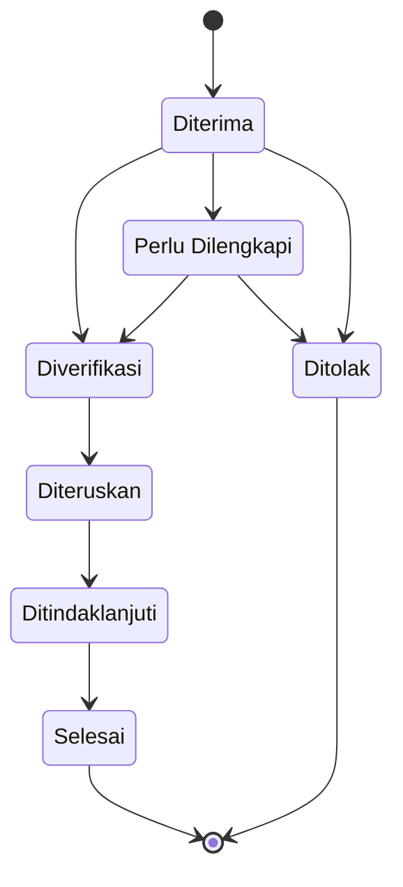

# SIAP — Sistem Informasi Aduan Publik

> **Prototipe antarmuka & alur pelaporan dugaan penyimpangan secara anonim.**
> Pelapor mengirim laporan tanpa identitas, menerima **kode tiket + PIN 6 digit**, lalu memantau penanganan sampai selesai. Petugas memproses laporan melalui antrean dan transisi status yang tercatat.

**Status:** Prototipe lomba (First Draft Submission) · **Seluruh data adalah contoh** · Tidak menerima laporan sungguhan.



---

## Daftar Isi

1. [Latar Belakang & Tujuan](#latar-belakang--tujuan)
2. [Fitur Utama](#fitur-utama)
3. [Tech Stack](#tech-stack)
4. [Cara Menjalankan](#cara-menjalankan)
5. [Akun & Tiket Demo](#akun--tiket-demo)
6. [Struktur Folder](#struktur-folder)
7. [Sitemap](#sitemap)
8. [Alur Status](#alur-status)
9. [Keterlacakan PRD](#keterlacakan-prd)
10. [Screenshot](#screenshot)
11. [Desain & Wireframe](#desain--wireframe)
12. [Status & Progress](#status--progress)
13. [Keamanan & Batasan](#keamanan--batasan)

---

## Latar Belakang & Tujuan

Pelaporan dugaan penyimpangan sering terhambat rasa takut terhadap pembalasan. SIAP dirancang sebagai ruang aman untuk bersuara:

- **Anonim sejak awal** — formulir tidak meminta nama, email, atau nomor telepon.
- **Akses pribadi berbasis tiket + PIN** — pelapor memegang kendali atas tiketnya tanpa membuat akun.
- **Tindak lanjut yang terlihat** — status, pesan admin, permintaan kelengkapan, dan ringkasan hasil dapat dibaca pelapor.
- **Transparansi publik** — dashboard agregat menampilkan tren penanganan tanpa membuka isi aduan.

Tujuan prototipe: mendemonstrasikan alur pelaporan anonim ujung-ke-ujung (pelapor, petugas, super admin, publik) sebagai dasar pengembangan sistem produksi.

---

## Fitur Utama

### Untuk pelapor
- Formulir laporan **3 langkah**: kejadian → bukti → tinjau.
- Unggah bukti JPG/PNG/PDF (maksimal 5 berkas, 10 MB per berkas).
- Penerbitan **kode tiket + PIN** (ditampilkan sekali) dan peringatan penyimpanan.
- Cek status dengan tiket + PIN, termasuk linimasa penanganan.
- Balas permintaan admin dengan pesan dan bukti tambahan.
- Membaca ringkasan hasil dan dokumen hasil saat tiket selesai.

### Untuk petugas (verifikator)
- Login petugas dengan peran `verifikator`.
- Antrean laporan dengan filter status, kategori, dan pencarian.
- Detail laporan + catatan internal.
- Transisi status: **verifikasi, minta dilengkapi, tolak, teruskan, tindak lanjut, selesai** — semuanya wajib beralasan dan tercatat.

### Untuk super admin
- Semua kemampuan verifikator.
- **Audit log** akses dan keputusan (hanya-baca).
- **Master data**: kategori, unit tujuan, dan akun petugas.

### Untuk publik
- Dashboard transparansi: statistik agregat, laporan per kategori, dan tren laporan masuk.
- Panduan & privasi.

---

## Tech Stack

| Lapisan                 | Teknologi                                        |
| ----------------------- | ------------------------------------------------ |
| UI                      | React 19 + TypeScript                            |
| Build                   | Vite 8                                           |
| Routing                 | React Router 8                                   |
| Styling                 | Tailwind CSS 4 + CSS design token kustom         |
| Lint                    | Oxlint                                           |
| Font                    | Inter Variable (`@fontsource-variable/inter`)    |
| Penyimpanan (backend)   | Express 5 + SQLite (better-sqlite3), sesi `httpOnly`, enkripsi end-to-end |

---

## Cara Menjalankan

Prasyarat: **Node.js LTS terbaru (22+)** dan npm.

```bash
# dari root repository
cd web

npm install
npm run dev        # http://localhost:5173
```

Perintah lain:

```bash
npm run lint       # oxlint
npm run build      # tsc -b && vite build
npm run preview    # menyajikan hasil build
```

> Aplikasi berada di folder `web/`, bukan di root repository. Data prototipe disimpan di `sessionStorage`, sehingga **hilang saat tab ditutup** dan hanya terlihat di browser yang sama.

---

## Akun & Tiket Demo

### Akun petugas

| Email                        | Kata sandi    | Peran       |
| ---------------------------- | ------------- | ----------- |
| `verifikator@contoh.invalid` | `verif-admin` | verifikator |
| `pengelola@contoh.invalid`   | `super-admin` | super_admin |

Akses panel petugas melalui tautan **“Akses petugas →”** di footer atau langsung ke `/petugas`.

### Tiket contoh

| Kode tiket        | PIN      | Status           |
| ----------------- | -------- | ---------------- |
| `SIAP-DEMO-7K4M9` | `482619` | Perlu Dilengkapi |
| `SIAP-DEMO-2Q6R8` | `730215` | Selesai          |
| `SIAP-FL-K8N3R`   | `901234` | Diterima         |
| `SIAP-FL-P4W7Q`   | `567890` | Diterima         |
| `SIAP-FL-M9V2T`   | `345678` | Perlu Dilengkapi |
| `SIAP-FL-B6D8L`   | `234567` | Ditolak          |
| `SIAP-FL-R3H5Y`   | `123456` | Diteruskan       |
| `SIAP-FL-T7J2N`   | `890123` | Ditindaklanjuti  |

Semua tiket, nama unit, dan percakapan adalah **data contoh** untuk simulasi.

---

## Struktur Folder

```
web/
├── docs/                     # screenshot untuk dokumentasi
├── public/
├── src/
│   ├── App.tsx               # definisi 22 rute
│   ├── main.tsx
│   ├── styles.css            # design token & komponen CSS
│   ├── components/           # Page, Card, Field, StatusBadge, Feedback, dll.
│   ├── lib/
│   │   ├── types.ts          # tipe domain + konstanta validasi
│   │   ├── api.ts            # lapisan abstraksi data (api & adminApi)
│   │   ├── mock-db.ts        # penyimpanan sessionStorage (prototipe)
│   │   ├── mock-data.ts      # seed tiket, admin, audit, transparansi
│   │   ├── format.ts         # format tanggal & ukuran Indonesia
│   │   └── upload.ts         # konstanta validasi berkas
│   └── pages/                # 22 halaman publik, petugas, super admin
├── index.html
├── package.json
└── vite.config.ts
```

---

## Sitemap



---

## Alur Status



Catatan: balasan pelapor **tidak otomatis** mengubah status. Tiket tetap `Perlu Dilengkapi` sampai admin memeriksa ulang.

---

## Keterlacakan PRD

| Kebutuhan | Layar                                                  |
| --------- | ------------------------------------------------------ |
| F-01–F-06 | `lapor`, `bukti`, `tinjau`, `terkirim`                 |
| F-09–F-12 | `cek`, `tiket`, `balas`, `balas-terkirim`              |
| F-13–F-17 | `petugas` (login), `antrean`, `detail`, `verifikasi`,  |
|           | `lengkapi`, `tolak`, `teruskan`, `tindakan`, `selesai` |
| F-18      | `petugas/audit`                                        |
| F-19      | `petugas/master` (ringkasan; CRUD belum dirinci)       |
| F-20–F-23 | `transparansi`                                         |
| F-07–F-08 | Ditunda: identitas terverifikasi dan peta              |

---

## Screenshot

Desktop : 
Mobile  : 

Screenshot merupakan pratinjau rancangan (mock-up) dari file desain SIAP.

---

## Desain & Wireframe

Rancangan antarmuka lengkap (wireframe, mock-up, dan prototype interaktif) tersedia di Figma:

- [Wireframe desktop](https://www.figma.com/design/I6y3NdiGXwkWVwcahYevbo/SIAP?node-id=8-4668)
- [Mock-up desktop](https://www.figma.com/design/I6y3NdiGXwkWVwcahYevbo/SIAP?node-id=9-3)
- [Prototype desktop](https://www.figma.com/proto/I6y3NdiGXwkWVwcahYevbo/SIAP?node-id=9-3&starting-point-node-id=9%3A3)
- [Prototype mobile](https://www.figma.com/proto/I6y3NdiGXwkWVwcahYevbo/SIAP?node-id=9-2296&starting-point-node-id=9%3A2296)

Rancangan mengikuti **PRD SIAP v1.0 (30 Oktober 2026)**: 28 layar dalam empat versi (wireframe/mock-up × desktop/mobile), total 112 frame.

---

## Status & Progress

### Fase 0 — Polesan submission ✅ (9 November 2026)
- [x] README lengkap (deskripsi, fitur, tech stack, cara run, kredensial, progress)
- [x] Sitemap Mermaid + tabel keterlacakan PRD
- [x] Screenshot desktop & mobile di `web/docs/`
- [x] Grafik transparansi (bar kategori + sparkline tren)
- [x] Badge status konsisten di seluruh halaman
- [x] Empty state & loading skeleton
- [x] Lint bersih (0 warning) & build hijau
- [x] Audit responsivitas 390 px + navigasi mobile
- [x] Validasi form inline di alur lapor

### Fase 1 — Backend & database nyata (rencana)
- [ ] Express + database relasional (SQLite/PostgreSQL)
- [ ] Endpoint publik & admin, sesi httpOnly, upload bukti ke server
- [ ] Migrasi `api.ts` dari `sessionStorage` ke REST API

### Fase 2 — Panel admin fungsional (rencana)
- [ ] Transisi status, pesan dua arah, master data CRUD di server
- [ ] Penegakan peran `verifikator` / `super_admin` di server
- [ ] Audit log server-side append-only

### Fase 3 — Keamanan & anonimitas (rencana)
- [ ] Enkripsi end-to-end / zero-knowledge untuk isi laporan & bukti
- [ ] Kunci pemulihan acak (PIN 6 digit tidak cukup sebagai kunci enkripsi)
- [ ] Threat model & dokumentasi batasan

---

## Keamanan & Batasan

Ini adalah **prototipe lomba**, bukan sistem produksi. Lihat [`docs/threat-model.md`](docs/threat-model.md) untuk janjinya yang jujur.

**Yang dijamin (teknis):**
- Isi laporan, balasan, dan bukti terenkripsi **end-to-end** di browser (AES-GCM-256 + PBKDF2 310.000 iterasi + kunci pemulihan 128-bit yang hanya tampil sekali di `/terkirim`). Server & DB hanya menyimpan ciphertext.
- PIN tidak disimpan plaintext (PBKDF2-SHA256 150.000 iterasi); password admin bcrypt; sesi `httpOnly` + `SameSite=Lax`.
- Admin tidak dapat membaca isi sebelum pelapor menekan "Izinkan admin membaca" (berbagi kunci RSA-OAEP eksplisit); aksi tercatat di audit log append-only.
- Backend Express + SQLite nyata: data bertahan setelah restart, dua browser melihat data yang sama. Rate-limit login & cek tiket, tanpa log IP mentah/isi.
- Backend `server/` di `http://localhost:3001`, proxy `/api` dari `web/` (Vite).

**Yang tidak dijamin:**
- Perangkat pelapor yang terkompromi (malware, penyadapan) tetap bisa melihat isi setelah dekripsi — enkripsi tidak melindungi endpoint.
- **Kunci pemulihan hilang = isi hilang.** Tidak ada pemulihan via email/telepon karena anonim.
- PIN 6 digit tetap lemah untuk lookup; keamanan isi bertumpu pada kunci pemulihan, bukan PIN.
- Metadata (kategori, status, waktu) tetap plaintext untuk transparansi agregat & antrean.
- Klaim privasi bersifat **teknis-demonstratif**, bukan jaminan hukum — perlindungan hukum butuh kebijakan resmi dan audit profesional.
- Data contoh tidak boleh diganti data pribadi sungguhan. Aplikasi ini tidak menerima laporan nyata.

**Cara menjalankan (backend + frontend):**
```bash
# terminal 1: cd server && npm install && npm run dev   # :3001
# terminal 2: cd web && npm install && npm run dev      # :5173, proxy /api -> :3001
```

---

## Disclaimer

SIAP adalah prototipe lomba. Seluruh nama unit, angka, tiket, bukti, dan percakapan merupakan **data contoh**. Aplikasi ini tidak menerima laporan nyata dan tidak mewakili instansi mana pun.
